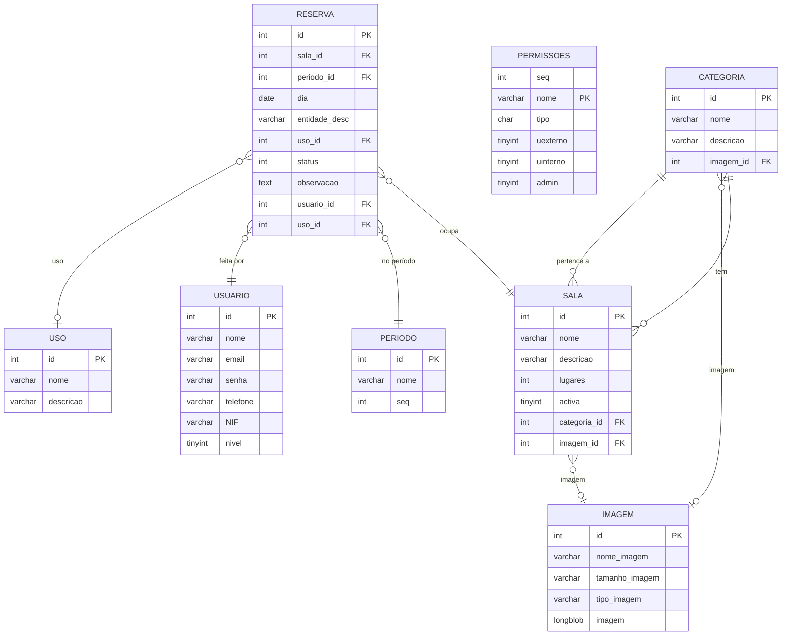

# Diagrama ER — Base de dados sgreserva

Representação em Mermaid das tabelas e relações da aplicação.

## Notas
- `PERMISSOES` não tem FK para utilizador; as permissões são por nível (0=User, 1=Gestor, 2=Admin, 3=SuperAdmin).
- `USO` é referenciado por `RESERVA.uso_id` (ON DELETE SET NULL).
- `IMAGEM` é partilhada por `CATEGORIA` e `SALA` (ON DELETE SET NULL).
